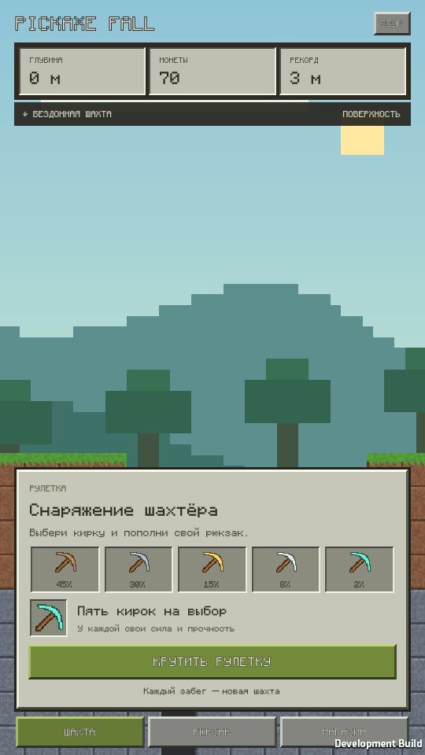
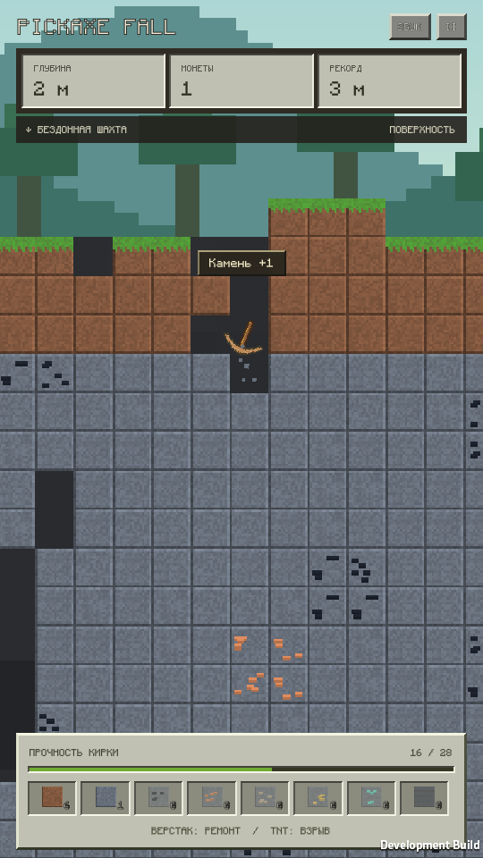
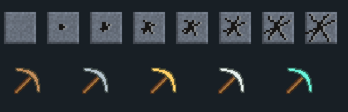

# PickaxeFall

2D-прототип для Android в вертикальной ориентации: **рулетка → кирка → физическое падение → добыча → верстаки → новый рекорд**.

**Unity 6000.4.0f1 · C# · Built-in Render Pipeline · UI Toolkit · Physics 2D**

<p>
  
  
</p>

## Запуск

1. Добавить эту папку в Unity Hub и открыть в **6000.4.0f1**.
2. Открыть `Assets/PickaxeFall/Scenes/Main.unity`.
3. Нажать **Play**. Для Game View выбрать вертикальный формат **9:16**, например 540×960.
4. Нажать **«Крутить рулетку»**, затем **«В шахту»**.

Кирка появляется в небе, на высоте **7,5 блока** над поверхностью, и падает самостоятельно. Бокового управления сейчас нет. **Escape** или **II** открывают паузу. Звук переключается сверху. При сворачивании приложения забег ставится на паузу.

Между забегами доступны вкладки **«Шахта»**, **«Рюкзак»** и **«Магазин»**. В рюкзаке показаны накопленные материалы; магазин пока представляет собой оформленную заглушку без покупок.

## Что работает

- Пять кирок с разными шансами выпадения, уроном, массой и прочностью; рулетка визуально замедляется перед результатом.
- Настоящее падение, вращение и отскоки Rigidbody2D, составной коллайдер головы и рукояти, непрерывное обнаружение столкновений.
- После ударов кирка получает небольшой вертикальный импульс и подпрыгивает примерно на **0,2 блока**. Сила подскока настраивается через `hitHopSpeed` в балансе.
- Каждый новый раунд получает новый seed и процедурную шахту: переменный рельеф, пещеры, рудные жилы и размещение верстаков и TNT. Ширина — **41 блок**; блоки подгружаются и возвращаются в пул.
- Земля, камень, уголь, медь, железо, золото, алмазы и глубинный сланец. Прочность блока определяет число ударов: `ceil(здоровье / урон кирки)`.
- Прочность кирки расходуется на каждый удар. Контакт с твёрдым блоком продолжает добычу даже после остановки кирки.
- Один удар раз в **0,7 секунды** на всю кирку: одновременный контакт с несколькими блоками не создаёт пачку ударов. На полностью непрозрачных блоках нарастают трещины восьми стадий.
- Верстаки случайно размещаются с глубины **12 м** по всей ширине карты, с расстоянием не менее **8 блоков**. Они повышают класс на одну ступень и полностью ремонтируют инструмент. Алмазная кирка только ремонтируется.
- TNT появляется с глубины **8 м**, с расстоянием не менее **2 блоков** между зарядами. Взрыв радиусом **2,1 блока** может запустить цепную реакцию. Соседство с верстаками исключено.
- Монеты и статистика добытой руды, экран результатов, повторный забег, сохранение рекорда и кошелька локально.
- Каждый сломанный блок-ресурс добавляет один предмет: земля, камень, уголь, медь, железо, золото, алмаз или сланец. Во время падения видна компактная панель добычи, в результатах — все восемь счётчиков текущего забега, в рюкзаке — накопленные запасы.
- Рюкзак сохраняется при завершении забега, сворачивании и выходе. Новый забег очищает только счётчики текущей добычи. Взрыв TNT тоже собирает разрушенные материалы; сам TNT и верстак остаются взаимодействиями.
- Меню оформлены как блочный инвентарь: серые панели с объёмными рамками, утопленные ячейки, счётчики предметов, пиксельный сундук и каменные кнопки. [Рюкзак](Docs/Screenshots/08-inventory.png), [магазин-заглушка](Docs/Screenshots/07-shop.png).
- Симметричная пиксельная кирка с двумя одинаковыми концами головки: видимая длина около **1,07 блока**, коллайдер повторяет головку и рукоять. При поломке кирка рассыпается на фрагменты собственного спрайта; результаты появляются после анимации.
- Верстак с сеткой и инструментами, небо, облака, солнце, горы и лес. У глубинных руд основа совпадает по цвету со сланцем.
- Весь интерфейс использует пиксельный шрифт **Monocraft** с кириллицей; TTF и лицензия SIL OFL 1.1 включены в проект. [Источник и атрибуция](Assets/PickaxeFall/Resources/Fonts/SOURCE.md).
- Пиксельная графика, частицы и короткие звуки генерируются проектом.
- Портретный интерфейс с учётом безопасной области экрана, вырезов и панели жестов.

Сеттинг вдохновлён блочной шахтой; оригинальные текстуры, логотипы и звуки Minecraft не используются.



## Баланс

Выбрать **`Assets/PickaxeFall/Data/DefaultBalance.asset`** в Inspector. Здесь меняются кирки, шансы рулетки, здоровье и награды блоков, глубина появления и вероятность руды, ширина и подгрузка шахты, верстаки, TNT, высота спавна, гравитация и частота ударов.

| Кирка | Шанс | Урон | Прочность |
|---|---:|---:|---:|
| Деревянная | 45% | 1 | 28 |
| Каменная | 30% | 2 | 30 |
| Золотая | 15% | 3 | 32 |
| Железная | 8% | 4 | 34 |
| Алмазная | 2% | 5 | 36 |

Улучшение на верстаке идёт по порядку **деревянная → каменная → золотая → железная → алмазная**. Железная сильнее и прочнее золотой. Шанс выпадения и характеристики — отдельные параметры.

Рулетка использует взвешенный случайный выбор. Проценты в интерфейсе и результат рассчитываются из одних весов через `GameBalance`. Выбор фиксируется один раз при нажатии; анимация показывает его в конце и не меняет результат. Новый seed карты получается независимо от рулетки. На короткой серии выпадений частоты могут отклоняться от процентов.

Ориентир без постоянных улучшений — **15–30 секунд и примерно 5–15 м** для обычных кирок. После добавления подскоков повторно проверены 40 физических забегов: деревянная обычно около 20 секунд и 4 м, каменная — около 22 секунд и 6–7 м. Подскоки и повороты могут сделать путь шире и немного уменьшить глубину. Редкие кирки, TNT и верстак дают преимущество. Это стартовый баланс, а не гарантия одинаковой глубины для каждого seed.

Монеты сохраняются между завершёнными забегами. Земля не даёт монет, но собирается в рюкзак; камень даёт 1 монету, руда — больше. В магазине пока только заглушка: покупок, продажи ресурсов и постоянных улучшений нет. Новые карты, уровни и классы кирок не добавлялись.

## Android

В Unity Hub для **6000.4.0f1** установить **Android Build Support**, включая **Android SDK & NDK Tools** и **OpenJDK**. В текущей среде эти модули отсутствуют; готовый APK в репозиторий не включён.

Далее использовать меню **PickaxeFall → Build Android APK**, либо открыть **File → Build Profiles**, выбрать Android, переключить платформу и собрать проект. Сцена Main уже включена в сборку.

Настроены **Portrait**, **ARM64**, **IL2CPP**, минимальный **Android API 26**, идентификатор `com.enotikpoker.pickaxefall`. Команда меню сохраняет APK в `Builds/Android/PickaxeFall.apk`. Для публикации понадобится собственная подпись; ключи и сборки исключены из Git.

## Проверки

**PickaxeFall → Validate game balance** проверяет 100 000 выпадений рулетки, 32 карты, расстояния между специальными блоками, независимость от маршрута, непрозрачность блоков, стадии трещин, симметрию и размер кирки.

**PickaxeFall → Build Linux smoke-test player** собирает Development-версию для проверки игрового цикла. Запуск из корня репозитория:

```bash
./Builds/Linux/PickaxeFall.x86_64 --smoke-test -screen-width 540 -screen-height 960 -logFile /tmp/pickaxefall-smoke.log
```

Для сервера без графики добавить `-batchmode -nographics`. Проверка проходит через рулетку, новые и повторяемые карты, спавн над землёй при первом и повторном запуске, реальные столкновения и добычу, TNT и цепные реакции, расход прочности, ремонт и улучшение, паузу, подгрузку шахты, награды и перезапуск. Также проверяются кириллица шрифта и каменная основа глубинной руды. Успех отмечается `PICKAXEFALL_SMOKE_OK` и кодом выхода 0. В графическом режиме сохраняются скриншоты в `Docs/Screenshots`.

Дополнительно проверяются вертикальная скорость при подскоках, сбор и сохранение каждого материала, вкладки и видимость их кнопок, неизменность результатов при навигации и защита от повторного начисления ресурсов. Повторный запуск player с тем же тестовым профилем проверяет загрузку рюкзака с диска.

Для серии из 40 полных физических забегов запустить тот же Development player с `--balance-probe -batchmode -nographics`. Сценарий использует отдельные seed для каждой из пяти кирок, ускоряет игровое время и сохраняет CSV в `/tmp/pickaxefall-balance.csv`. Для изоляции сохранений можно задать `XDG_CONFIG_HOME` в отдельную тестовую папку. Результат текущего прогона: [Docs/BalanceRuns.csv](Docs/BalanceRuns.csv).

Меню **PickaxeFall → Create or rebuild main scene** пересоздаёт стартовую сцену и настройки платформы, сохраняя существующий asset баланса. Оно заменяет текущую сцену; перед использованием нужно сохранить ручные изменения.

Результаты выполненных проверок: [Docs/Verification.md](Docs/Verification.md).

## Развитие

Описание устройства проекта: [Docs/Architecture.md](Docs/Architecture.md). Игровые правила и дальнейшие шаги: [Docs/GameDesign.md](Docs/GameDesign.md).

Документация движка: [Rigidbody2D](https://docs.unity3d.com/6000.0/Documentation/ScriptReference/Rigidbody2D.html), [Android Player settings](https://docs.unity3d.com/6000.0/Documentation/Manual/class-PlayerSettingsAndroid.html).
